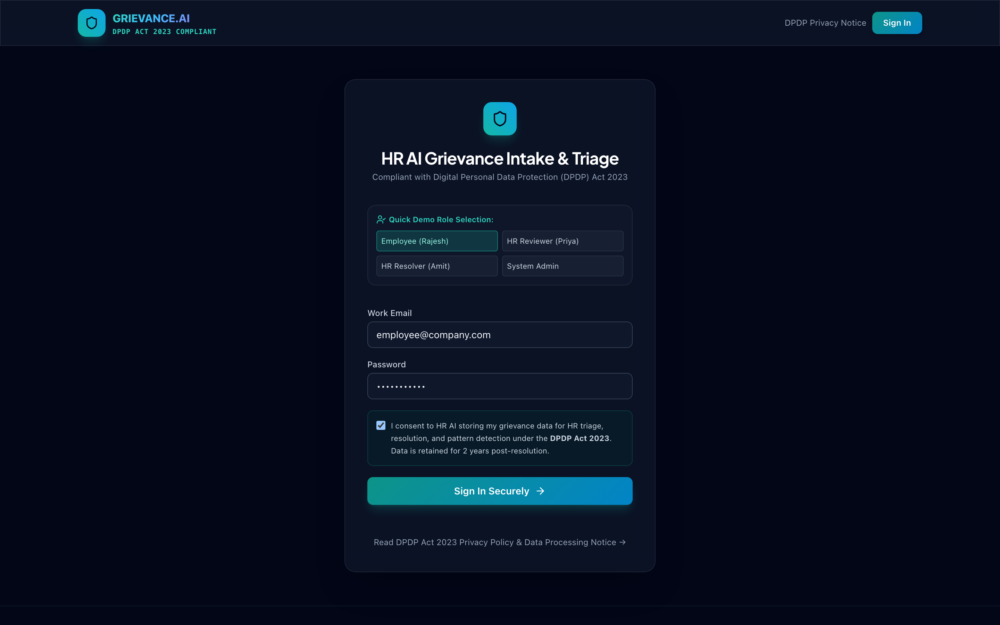
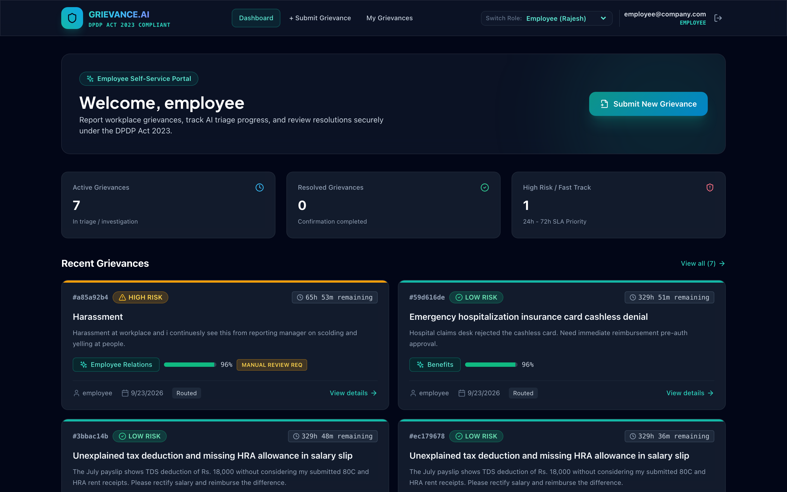
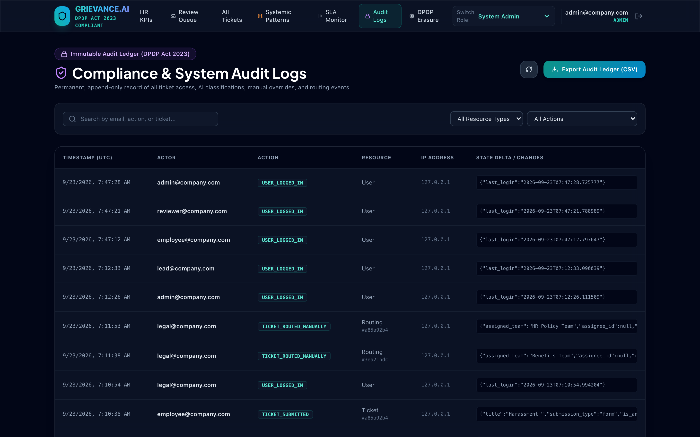
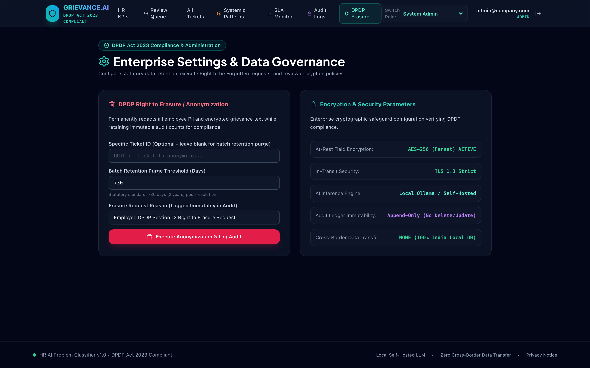

# HR AI Problem Classification & Triage System - Visual Tour & Screenshots

A comprehensive visual walkthrough of the full-stack web application designed for enterprise grievance intake, AI multi-classification, predictive routing, SLA monitoring, systemic pattern detection, and statutory DPDP Act 2023 compliance.

---

## 1. Authentication & DPDP Statutory Consent

The entry portal features enterprise role selection, encrypted session tokens, and mandatory **DPDP Act 2023** explicit consent capture with database timestamp logging.

---

## 2. Employee Self-Service Dashboard

Employees can view their active, resolved, and critical priority grievances, monitor resolution timelines, and access fast-submission options.

---

## 3. Multi-Channel Grievance Intake with Real-Time AI Auto-Population

Intake form supporting Web Forms, Email, Chat, Support Tickets, and Exit Interviews. As the employee describes their problem, the system **auto-populates suggested HR categories** (Payroll, Leave & Attendance, Benefits, Policy, Employee Relations, Recruitment, L&D, General Query) with **"Others"** as the fallback.

---

## 4. Grievance Tracking, AI Reasoning & Resolution Feedback Loop

Detailed case view displaying AES-256 decrypted descriptions, zero-shot AI classification confidence, highlighted risk keywords, full audit progression timeline, official PDF export, and the employee resolution confirmation / dispute feedback loop.

---

## 5. HR Operations & Analytics Command Center

Executive triage dashboard showcasing real-time KPIs, 13-category distribution charts (Recharts), and SLA risk tier breakdowns.

---

## 6. HR Triage Review & Classification Override Queue

Interactive review queue where HR personnel inspect AI classifications, confidence scores, and reasoning. Includes inline modals for **Manual Classification Override** (with mandatory audit reasoning), **Team Routing**, and **Case Resolution**.

---

## 7. Real-Time SLA Enforcement & Escalation Monitor

Tracks live SLA countdowns across risk tiers (Critical 24h, High 72h, Medium 7d, Low 14d) and flags at-risk (>75% elapsed) or overdue cases for automatic leadership escalation.

---

## 8. AI Systemic Pattern Clustering Hotspots

Embeddings clustering engine that analyzes grievances across a sliding 7-day window. When ≥3 similar issues are identified, a systemic hotspot alert is generated with leadership recommendation and formal investigation workflows.

---

## 9. DPDP Act 2023 Immutable Audit Ledger

Append-only compliance ledger tracking actor, action, resource, timestamp, and IP address. Supports 1-click CSV export for statutory compliance audits.

---

## 10. Enterprise Data Governance & Right to Erasure

Configures statutory 2-year data retention and provides tools to execute **DPDP Section 12 Right to be Forgotten** requests by permanently redacting employee PII.

